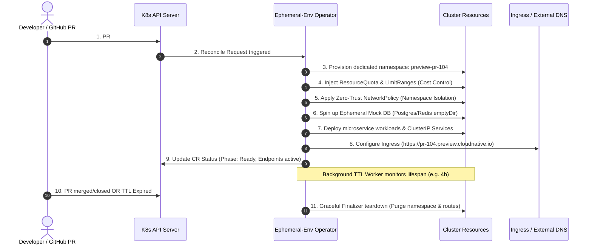

# Ephemeral Environment Operator 🚀

[](https://go.dev/)
[](https://kubernetes.io/)
[](https://kubernetes.io/docs/concepts/extend-kubernetes/api-extension/custom-resources/)
[](https://opensource.org/licenses/MIT)

> **Production-grade Kubernetes Operator & Controller-Runtime** engineered for **Internal Developer Platforms (IDP)**. Dynamically spins up, secures, and automatically garbage-collects isolated full-stack **Ephemeral Preview Environments** on every Pull Request.

---

## 🏗️ Architecture & Lifecycle Workflow



---

## 🌟 Key Capabilities

* **⚡ Declarative CRD (`PreviewEnvironment`):** Developers declare isolated environments via GitOps or GitHub Actions PR triggers.
* **🛡️ Zero-Trust Network Isolation:** Automatically enforces default-deny ingress policies between preview environments to prevent noisy neighbors and data leakage.
* **💰 FinOps Guardrails & ResourceQuotas:** Enforces CPU, Memory, and Pod bounds per environment to eliminate runaway cloud costs.
* **⏱️ Automated TTL Garbage Collection:** Native reconciler requeue + background scanner automatically terminates environments when their TTL (e.g. `2h`, `24h`) expires.
* **🗄️ Ephemeral State Provisioner:** Provisions on-demand mock databases (`Postgres`, `Redis`, `MongoDB`, `MySQL`) using in-memory or emptyDir storage.
* **🌐 Dynamic Ingress Templating:** Computes subdomains based on templates (`pr-{{.PRNumber}}.preview.example.com`) with automated TLS secret generation.
* **🔒 Validating Admission Webhook:** Rejects invalid PR numbers, illegal branch ref naming, and TTL policy violations exceeding company limits (>72h).
* **📊 Prometheus Metrics Exporter:** Exposes operational metrics (`ephemeral_env_created_total`, `ephemeral_env_active_gauge`, `ephemeral_env_destroyed_total`).

---

## 📋 Custom Resource Definition (`PreviewEnvironment`)

```yaml
apiVersion: idp.cloudnative.io/v1alpha1
kind: PreviewEnvironment
metadata:
  name: preview-pr-104
spec:
  branch: feature/checkout-v2
  prNumber: 104
  repository: github.com/ekrmcakir/ecommerce-core
  author: ekrmcakir
  ttl: 4h
  autoCleanup: true
  isolatedNetwork: true
  ingress:
    enabled: true
    hostTemplate: "pr-{{.PRNumber}}.preview.cloudnative.io"
    ingressClassName: nginx
    path: /
    tls: true
  resources:
    cpuLimit: "3000m"
    memoryLimit: "6Gi"
    maxPods: 20
  mockDatabase:
    engine: postgres
    databaseName: checkout_preview
    ephemeral: true
  workloads:
  - name: checkout-api
    image: ghcr.io/ekrmcakir/checkout-api:v2.4.0
    port: 8080
    replicas: 2
    env:
    - name: DB_HOST
      value: database
    - name: DB_NAME
      value: checkout_preview
    - name: DB_USER
      value: preview
    - name: DB_PASSWORD
      value: previewpass
```

---

## 🚀 Quickstart & Local Installation

### Prerequisites
* Go 1.24+
* Docker / Podman
* `kubectl` and a test cluster (Kind / Minikube / EKS)

### 1. Clone & Build
```bash
git clone https://github.com/ekrmcakir/ephemeral-env-operator.git
cd ephemeral-env-operator

# Run tests
make test

# Build binary
make build
```

### 2. Install CRDs & Deploy Operator
```bash
# Register CRDs
make install

# Run controller locally against your current kubeconfig:
make run
```

### 3. Deploy a Sample Preview Environment
```bash
kubectl apply -f config/samples/full-preview-env.yaml

# Watch environment provisioning in real time
kubectl get previewenvironments.idp.cloudnative.io -w
```

Output:
```text
NAME             PR    BRANCH                PHASE   NAMESPACE        TTL   EXPIRESAT              AGE
preview-pr-104   104   feature/checkout-v2   Ready   preview-pr-104   4h    2026-10-16T22:15:00Z   25s
```

---

## 📈 Observability & Prometheus Metrics

The operator exposes Prometheus metrics on `:8080/metrics`:

| Metric Name | Type | Description |
| :--- | :--- | :--- |
| `ephemeral_env_created_total` | Counter | Total preview environments created |
| `ephemeral_env_destroyed_total` | Counter | Total preview environments purged via TTL or PR close |
| `ephemeral_env_active_gauge` | Gauge | Currently active ephemeral environments running in cluster |

---

## 🛡️ Security & Governance Guardrails

1. **Restricted Pod Security Standard:** Provisioned namespaces enforce Kubernetes `pod-security.kubernetes.io/enforce: restricted`.
2. **Admission Webhook Checks:**
   * Prevents mutation of immutable fields (`spec.prNumber`).
   * Caps maximum TTL duration to `72h`.
   * Enforces container port boundaries `[1, 65535]`.

---

## 📜 License
Released under the [MIT License](LICENSE). Built by **Ekrem Cakir** (@ekrmcakir).
